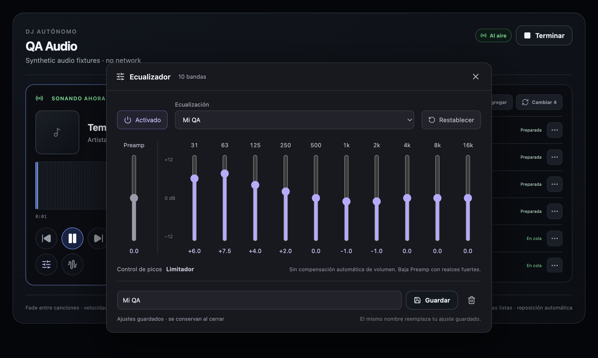

# Reserva, limpieza y ecualizador — 2026-10-10

Implementación en `feature/visualizer`, sin commit/push de este nuevo bloque.
Contrato: [`PLAYBACK_RESERVE_AND_EQUALIZER.md`](../contracts/PLAYBACK_RESERVE_AND_EQUALIZER.md).
Verificado en macOS arm64 con Electron 44.4.3. No constituye QA de los paquetes
Windows ni macOS Universal, ni una revisión auditiva prolongada con música real.

## Qué cambia

- Cuatro próximas pistas descargadas, decodificadas y analizadas; dos trabajos
  concurrentes priorizados por el orden de la cola. El primer resultado desbloquea
  Siguiente. Al avanzar se reponen las reservas sin esperar al fin del crossfade.
- Reordenar conserva los buffers por ID. Resultados retirados/cancelados no
  alteran la cola, los decks ni reabren un AudioContext después de terminar.
- Los saltos rápidos completan la transición previa antes de reutilizar el deck;
  se cancelan sus temporizadores. Pausar no cancela la preparación de la reserva.
- Al guardar cada cambio de pista se conservan la actual, cuatro anteriores y
  todas las futuras. El resto del historial conserva sus metadatos, pero pierde
  sus archivos temporales. Un tema eliminado puede descargarse de nuevo al volver.
- Las leases aplazan la eliminación hasta la última liberación. Los candidatos
  pendientes persisten y se revisan también al arrancar y en la limpieza periódica.
  Se eliminan todos los formatos administrados de un mismo ID, no solo uno.
- Ecualizador de diez bandas ±12 dB con preamp independiente, activación/bypass,
  reset y limitador existente, sin compensación automática por banda. Solo ocho estilos predefinidos: Rock, Salsa,
  Merengue, Bajos, Agudos, Reggae, Rap, R&B. Hasta veinte ajustes personales.
- Ajustes globales persistentes, archivo atómico, backup y errores visibles con
  reintento. La ventana es no modal, arrastrable y se cierra con Escape cuando
  tiene el foco; cerrar no desactiva la ecualización.

## Comprobaciones reproducibles

```sh
pnpm check
pnpm verify:audio-features
pnpm verify:equalizer-startup
pnpm verify:visualizer
pnpm verify:visualizer-ui
```

Las pruebas usan perfiles/archivos temporales y audio sintético; no borran la
caché real, no consultan YouTube ni reproducen audio por los altavoces.

Resultados:

- TypeScript, **133 tests en 30 archivos**, producción Electron + Vite: pasan.
- Pruebas de reserva con promesas controladas: límite cuatro, concurrencia dos,
  desbloqueo del primero, reposición, reutilización al reordenar, fallos y reset.
- Pruebas de disco: con tema9 actual se borran exactamente tema1–tema4;
  leases, reinicio, IDs repetidos protegidos, barridos concurrentes y formatos
  múltiples. La limpieza manual tampoco borra el rango protegido.
- Prueba Electron del panel real bajo React StrictMode: carga de sesión,
  primer tema listo sin esperar a los otros tres, pausa durante preparación,
  cuatro preparados, reordenamiento sin nueva descarga, tres saltos en **94 ms**
  en fixtures ya preparados, reposición y supervivencia del deck tras seis
  segundos. Ese tiempo no es una promesa de latencia para descargas reales.
- Fuente fallida retirada y reserva repuesta sin interrumpir la pista actual.
- Stop con preparación pendiente: cero lecturas/decodificaciones posteriores
  de resultados obsoletos; **cero leases restantes**.
- Diez bandas + preamp, exactamente ocho presets, ajuste manual, guardado
  personal por IPC en repositorio real, cierre/reapertura, Escape y restauración
  del ajuste tras remontar el renderer. Fallo de disco simulado mostrado y
  reintento que efectivamente guarda el estado aplicado.
- PCM real con OfflineAudioContext: Bajos cambia la relación 63 Hz/1 kHz a
  **2.5146**, Agudos cambia 8 kHz/1 kHz a **1.6707**. El RMS de bypass y plano
  coincide (**0.1414213**). Todos los valores finitos. Bandas individuales de
  31 Hz y 16 kHz a ±12 dB cambian su frecuencia en ±12 dB, mientras 1 kHz
  cambia como máximo **0.01186 dB**, también a través de safety/limitador.
- Regresión del visualizador: ocho presets distintos, audio post-master,
  silencio al mutear, crossfade y controles de ventana pasan. PCM medio audible
  **0.1401814**, mute **0** en esta ejecución.

Captura del panel real, no un mockup generado:



[Resultados de la prueba Electron](audio-features-verification/result.json).

## Límites pendientes de QA

- Escucha real prolongada y preferencias subjetivas de las curvas por género.
  Las curvas son ajustes de NeoAres, no estándares de masterización.
- Descarga real con red lenta/cortes prolongados y catálogos reales; el servicio
  tiene pruebas de timeout/cancelación/deduplicación, pero el probe no usa red.
- Paquetes Windows x64/macOS Universal y dispositivos con poca memoria. Cuatro
  buffers PCM completos consumen más RAM que cuatro archivos comprimidos; el
  límite de cuatro evita crecimiento indefinido, no elimina ese coste.
- El limitador existente no es una garantía brickwall/true-peak. En la prueba
  extrema (todas las bandas +12 dB y Preamp +12 dB), reduce **13.39 dB**, pero
  el pico todavía alcanza **1.0843**: puede saturar la salida. Usar Preamp para
  bajar el nivel con realces fuertes; no prometer ausencia de clipping arbitrario.

Para QA manual hay que **cerrar y volver a abrir NeoAres**: cambió el preload y
el proceso principal; HMR por sí solo no carga los nuevos canales del ecualizador.

## Corrección de carga del ecualizador — 2026-10-10

El registro de la instancia abierta mostraba `No handler registered for
'equalizer-settings:load'`: el renderer/preload nuevo se conectaba al proceso
principal iniciado antes de implementar el ecualizador. No era corrupción de
ajustes. Se reinició la aplicación sin borrar ni restablecer su configuración.

- El hook distingue puente ausente/canal no registrado de errores de disco.
  Si requiere reinicio, explica que recargar la ventana no basta, bloquea los
  cambios y no ofrece un reintento que no puede resolverlo.
- Los errores reales de almacenamiento mantienen el reintento y nunca sustituyen
  una configuración ilegible por valores por defecto para luego sobrescribirla.
- `verify:equalizer-startup` arranca el bundle principal y preload reales, con
  perfil aislado, y verifica carga + guardado + lectura por los canales reales.
- El probe de audio reproduce el proceso antiguo y el fallo de almacenamiento,
  comprueba controles bloqueados, conservación de ajustes y recuperación por
  reintento; también siguen pasando las pruebas de PCM, reserva y saltos.
- Verificación adicional en la instancia real reiniciada, sin cambiar su curva:
  carga IPC correcta, panel abierto con **11 controles habilitados**, **8 presets**
  y ningún mensaje de error. Esto no sustituye una escucha subjetiva con música.

## Referencias técnicas

Filtros y transición suave de parámetros implementados con Web Audio:
[BiquadFilterNode](https://developer.mozilla.org/en-US/docs/Web/API/BiquadFilterNode)
y [AudioParam.setTargetAtTime](https://developer.mozilla.org/en-US/docs/Web/API/AudioParam/setTargetAtTime).

## Corrección de bandas que parecían volumen — 2026-10-10

Se retiró la atenuación global calculada por el pico teórico de la curva. Antes,
subir una banda sin energía en la canción podía bajar toda la mezcla aunque esa
banda casi no fuera audible. Ahora la ganancia global del EQ solo depende de
Preamp; filtros y preamp conservan su suavizado, bypass y ajustes persistidos.
La UI ya no muestra un margen automático que no se aplica: indica el limitador
existente y aconseja bajar Preamp con realces fuertes. El contrato se actualizó.

Regresión reproducible con PCM real: 31 Hz y 16 kHz, tanto +12 como −12 dB,
mantienen el tono de 1 kHz dentro de 0.012 dB, con y sin el limitador. El test
anterior de relaciones entre bandas no bastaba: una atenuación global también
preserva esas relaciones. Por eso ahora se comprueba el nivel absoluto de una
frecuencia no afectada, además del cambio en la banda editada.

La app se cerró antes de cambiar el DSP para evitar un salto de nivel por HMR.
Se volvió a abrir con la compilación de producción y el perfil habitual, sin
restablecer curvas: 11 controles habilitados, 8 presets, aviso nuevo visible y
ningún error de carga. La apreciación auditiva con la música/dispositivo del
usuario sigue correspondiendo al QA manual.

Comportamiento del compresor Web Audio y su ganancia interna:
[W3C, DynamicsCompressorNode processing](https://www.w3.org/TR/webaudio-1.1/#DynamicsCompressorNode-processing).
